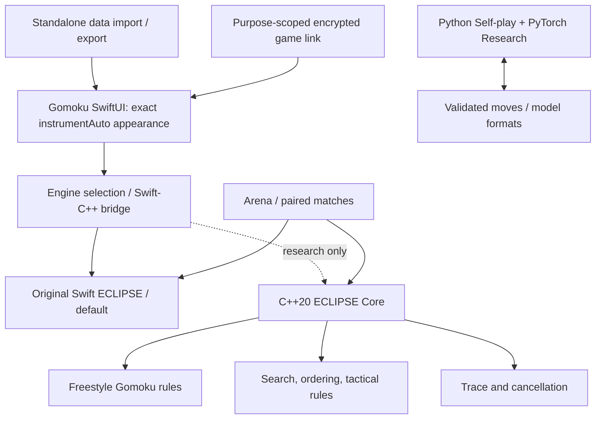

# Architectural decision record — Gomoku / ECLIPSE

## ADR-001: C++20 + Python/PyTorch + SwiftUI

### Context

Upstream VeilLink's playable Gomoku is mostly native Swift. Existing AI functions and hard-won tactical constraints should survive independent app extraction. The future research workflow needs headless engines, GPU-assisted training and reproducible paired matches without tying all experiments to Xcode/iOS. The compiled baseline in `Engine/` is a scaffold; it has **no** verified ECLIPSE-trained ordering and is **not** a replacement for the original Swift search.

### Decision

- **Product-facing iOS:** SwiftUI original source components, new `Gomoku` app target; fixed `VeilAppearanceSelection.instrumentAuto`. Swift original ECLIPSE default until C++ parity and strength sign-off.
- **Portable search:** C++20 `Engine` with C ABI; isolated per-game rule modules and instrumentation; avoid toolchain- or iOS-specific dependencies inside engine.
- **Training and experiments:** Python 3, standard JSONL moves and validated board-state records. Optional PyTorch weights are research artifacts, not bundled into shipping IPA until inference is proven.
- **Models:** Immutable model ID + license + source dataset + training metadata + experimental status; runtime check for rules compatibility. Search must always enforce legal action and forced tactical safety independent of learning model ranking.
- **In-app storage:** iOS `Application Support/Gomoku/` and versioned user-initiated imports/exports. Keep game models from Xiangqi separate.
- **Communication:** standalone BLE/E2EE game sessions. Reuse licensed transport concepts only. The model/API never depends on chat view or another installed app.

### Layer diagram

### Engine API contract (v0 prototype)

`Engine/include/eclipse_c_api.h`: `eg_create/destroy/reset/play/undo/best_move/copy_board/to_move/status/ply_count/engine_revision`. Indices are row-major `row*15+col`, values `0 empty, 1 black, 2 white`. Status `0 playing, 1 black won, 2 white won, 3 draw`. The prototype uses unrestricted freestyle >=5 line rules. No Renju forbidden-point logic has been implemented. Expansion to other rule sets requires a new ruleset ID and explicit protocol negotiation.

**Performance and parity responsibilities:** search is safe if it never emits an illegal move, respects device-limited computation and retains original defensive/win behavior. CPU time, nodes and deadline policies must be benchmarked on equal devices. Swift and C++ move choices need not be byte-identical when moves are equally legal and strong; the baseline tactical corpus must pass.

### Mandatory cancellation and thread rules for production

- Search off the UI thread; immutable board snapshot; cancel prior searches by generation token.
- Never mutate an active board from background task; only publish result after verifying session/move count still matches.
- Native API must reject stale results, invalid indices and ended games.
- Time limit is an evaluation budget, never permission to skip immediate mandatory win/block scan.
- Search traces must be derived from actual visited branches; never synthesize branches just for visuals.

### New repository first, optional future engine repository later

Monorepo first: `Gomoku/Apps`, `Engine`, `Training`, `Arena`, `Legacy`. Only extract universal `ECLIPSE-Core` into a second repo after API stability and at least two independently tested board game consumers; no premature genericization.
